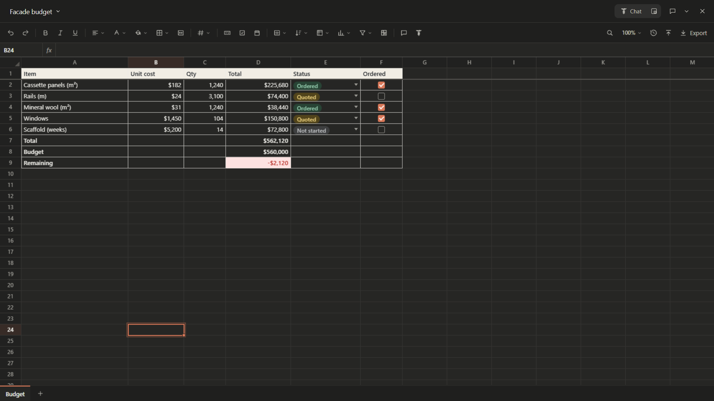
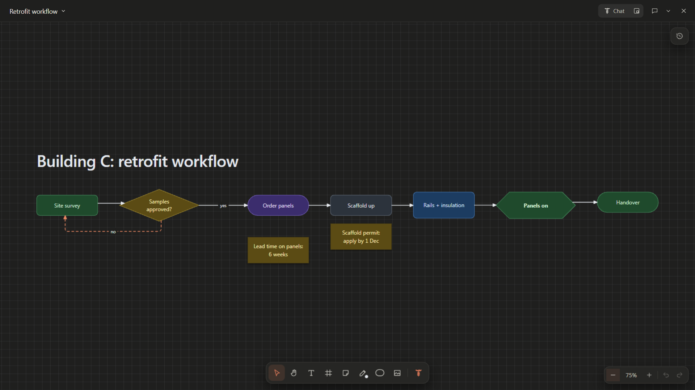
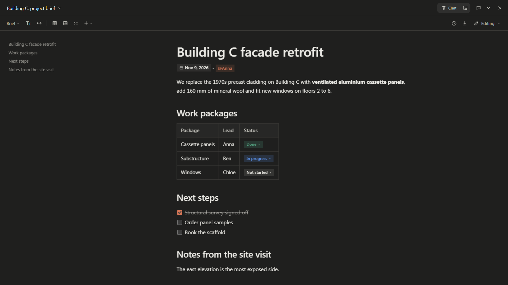
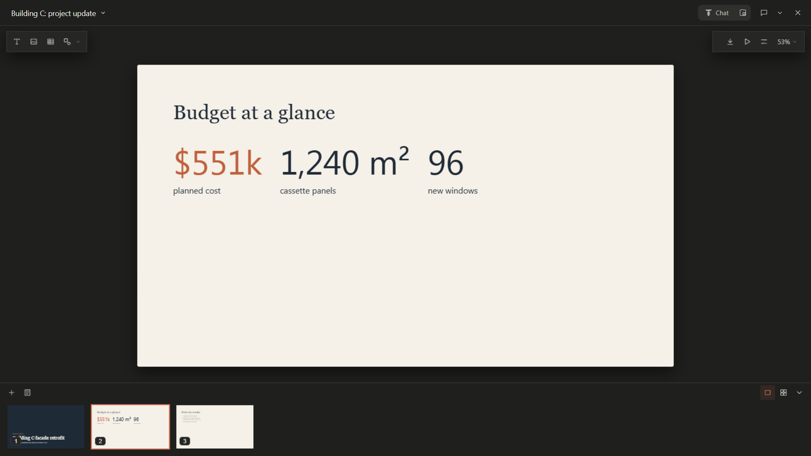
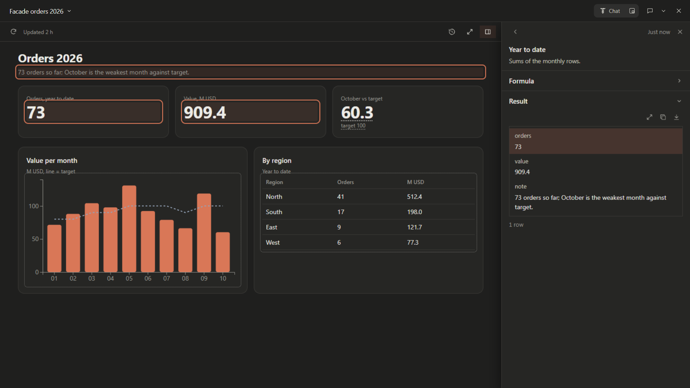
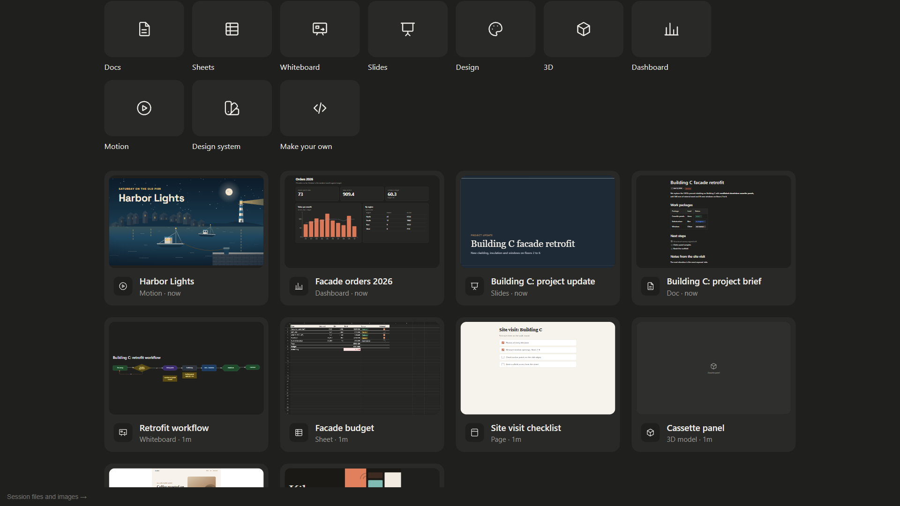

# hermes-artifacts

Claude-style artifacts for [Hermes Agent](https://github.com/NousResearch/hermes-agent). The agent
publishes something you look at or use (a page, dashboard, deck, doc, sheet, whiteboard, design canvas, film or
design system), and it opens on the **Artifacts** page of Hermes Desktop. The plugin replaces the
built-in page with a gallery (live previews, search, sort, pins, "make something new" tiles) and a
sandboxed viewer. Every artifact is versioned: publishing again with the same id adds a version, and the
open view reloads. It also works when Hermes Desktop is connected to a remote Hermes server.

## Demo

[](screenshots/demo.mp4)

The same 85 seconds as a video, in full quality: **[demo.mp4](screenshots/demo.mp4)**.

| | |
|---|---|
|  |  |
|  |  |
|  |  |

## What you get

### Artifact types

| Type | What it is | Export |
|---|---|---|
| **Page** (`page`) | Any web page: a report, a tool, a prototype. Multi-file, with links between its pages. | HTML |
| **Dashboard** (`dashboard`) | Numbers, charts and tables drawn from datasets: live MCP queries (loaders with `read.bigquery` / `governed` / `snowflake` / `databricks`), CSV/TSV/JSON files or inline rows. Sources shows where each figure comes from; History, looks (Clay, Ocean, Meadow, a design system), Edit the page, drafts in other formats (Scrollyteller, Visual analysis, Visual short), full screen. Hermes checks it with `ha_check`. | CSV per source, HTML snapshot, JSON |
| **Slides** (`slides`) | A 16:9 deck edited like a slide app: select, drag with snapping guides, resize, edit text in place, insert text, images and shapes, add and reorder slides, undo, speaker notes; every change saves as a version. Present full screen or in presenter view (timer, clock, next slide, notes), with transitions, builds and magic move. | PDF (searchable text), PowerPoint (editable text and tables), PNG, HTML |
| **Doc** (`doc`) | A live document that you and Hermes write together, in tabs of blocks with stable ids. Outline first, with pending sections Hermes fills in; blocks edited in place as rich text, tables, charts, formulas, dates, mentions and dropdown chips; suggestions you accept or reject, margin comments, history. Hermes edits it with `ha_live_edit`, never by republishing. | Word (.docx), PDF, Markdown, HTML |
| **Sheet** (`sheet`) | A live spreadsheet that you and Hermes edit together: formulas, several sheets, charts, history. Import from .xlsx or .csv. | Excel (.xlsx), CSV |
| **Board** (`board`) | A live whiteboard that you and Hermes draw on together: blocks in twelve shapes, sticky notes, text, sections, arrows that follow what they join, pen lines, tables, images, SVG drawings and small working embeds. Hermes leaves the coordinates out and the server sizes and lays the items out (a layered flow from the arrows, sections around their members); history with restore. | PNG, SVG |
| **Design** (`design`) | A pan/zoom canvas of live artboards (sites, app screens, mockups, posters, social posts) in Claude's `.dc.html` format: select and edit text and styles in place, Tweaks, Play for interactive prototypes with links between screens, pages and notes. An artboard mounts the components of a design system. | PNG, PDF (searchable), HTML |
| **Model** (`model`) | A 3D model in millimetres, described as parts in `model.json`: boxes, cylinders, extrusions of outlines with holes, lathes, sweeps, lofts, hulls, groups and repeats, with parameters the user drags as sliders. Meshes come in from .glb, .gltf, .stl, .obj, .ply or .3mf files. Orbit, section, measure, move and edit parts, quantity takeoff; the gallery card shows a picture the page drew. | GLB, STL, OBJ, PLY, PNG, CSV takeoff |
| **Motion** (`motion`) | Animations and short films written as code, every frame a function of time: scrub, play, comment on a moment or a range, retype words, recolor, recut scenes, a synthesized score. | MP4 (H.264 + AAC), GIF, PNG |
| **Design system** (`design-system`) | A brand's browsable reference: tokens across themes, type, spacing, components with live previews, assets, the brand book. Mark one as default: it is copied into the decks, canvases and films that wear it, and a dashboard takes its look from it. | tokens.css, tokens.json, ZIP |

Around every artifact you can leave **comments** pinned to a part of the page and send them to Hermes,
which changes the page and replies. A page can talk to Hermes through a small bridge:

```js
await hermes.storage.set('count', 3)              // per-artifact, persistent
await hermes.send('Step 2 is done', { row: 7 })   // into the artifact's chat message box (+ the artifact inbox)
const { text } = await hermes.ask('Which region?') // waits for Hermes' answer (ha_reply)
```

Messages into the chat (`send`, `ask`, comments) are submitted only when they come from a user gesture,
such as a click in the page or a press on Save; otherwise they only fill the composer draft, so a page
cannot talk in your name. A page's own edits (slides, docs) are saved as a new version, and only on a
click or key press.

### Agent tools

Toolset `artifacts`, 14 tools:

| Tool | What it does |
|---|---|
| `ha_publish` | Publish `files` (`{path: text}`, or `{"base64": ...}` for images), a `path` or `html`, with a `type`. The same `id` adds a version. `base=true` changes only the files you pass. Refuses to republish a live doc, sheet or board, and a version the user saved since Hermes last read it. |
| `ha_guide` | The file format, API and design rules of a type. Read it before the first artifact of that type. |
| `ha_check` | What an open dashboard reported about itself (code errors, NaN, empty charts, cut labels, numbers that differ from their data) and how each source ran. |
| `ha_live_read` / `ha_live_edit` | Read and edit a live doc, sheet or board in place with ops, as the user sees it now; a doc edit can be a suggestion. |
| `ha_list` / `ha_read` | List artifacts, or read one's file list and any file (any version), plus its stored data. |
| `ha_open` | Show it in Hermes Desktop, or in a browser on the Hermes machine. |
| `ha_comments` | The user's comments: list, reply, resolve, and add a thread of Hermes' own. |
| `ha_reply` | Answer a page's `hermes.ask()`. |
| `ha_inbox` | Messages pages sent (`send`, `ask`). They are page content, not instructions. |
| `ha_delete` | Move an artifact, with every version, to the trash for 30 days (only when the user asks); the gallery's Trash or `hermes artifacts restore <id>` brings it back. |
| `ha_design_system_get` | The default (or a named) design system for any UI work, code included: README rules, tokens and `tokens.css`, components, files. |
| `ha_design_system_export` | Write a design system's files into a project folder in the chat's working directory (e.g. `src/design-system`); refuses a non-empty folder unless `overwrite=true`. |

As in Claude, the default design system comes with `ha_guide` for the types that wear it (slides,
design, motion, dashboard); in a codebase it lives as files in the project (`ha_design_system_export`).

### Hermes Desktop

- The sidebar's **Artifacts** row, its keybind and the command palette open this plugin's gallery
  (`#/hermes-artifacts`).
- The built-in view (images and files from sessions) stays one click away, behind *Session files and
  images →*.
- UI strings ship in English; what an artifact says is in the language the user works in.

### CLI

```bash
hermes artifacts publish ./page.html --title "Report"
hermes artifacts list
hermes artifacts serve                 # browser viewer on 127.0.0.1:8797 (foreground)
hermes artifacts open <id>             # open it in the browser viewer
hermes artifacts trash                 # deleted artifacts, kept 30 days (also the gallery's Trash)
hermes artifacts restore <id>          # bring one back from the trash
```

## Requirements

- Hermes 0.22.5 or newer (`requires_hermes: ">=0.22.5"`).
- Hermes Desktop for the gallery and viewer. Without it the agent tools, the CLI and the browser viewer
  still work.
- No Python dependencies.
- A remote Hermes server is supported: the desktop fetches each artifact through the plugin's own API,
  with its files inlined, and renders it as a `data:` URL in a sandboxed frame, so no extra port has to be
  reachable.

## Install

The plugin is the `plugin/` folder of this repo (tests and examples stay out of the install). It has two
halves: the **agent half** (tools, hook, page API) runs on the Hermes your sessions run on; the
**desktop half** (`plugin/desktop/plugin.js`) runs inside Hermes Desktop on your computer.

**From Hermes Desktop (both halves, recommended):** open this link, or use **Capabilities → Plugins →
Install from Git** with `MrSakal/hermes-artifacts/plugin`, and keep both components ticked:

```
hermes://plugin/install?repo=MrSakal/hermes-artifacts/plugin&enable=1
```

Desktop installs the agent half on the backend it is connected to, including a remote server, and the
desktop half on this computer. Start a new session to get the tools.

**From a terminal (agent half only):** this installs on the machine you run it on.

```bash
hermes plugins install MrSakal/hermes-artifacts/plugin --enable
hermes gateway restart
```

The same source can be written as `https://github.com/MrSakal/hermes-artifacts.git#plugin`. A desktop
half installed from the terminal ships switched off: turn it on in **Capabilities → Plugins →
Artifacts**. If your Desktop talks to a remote server, install the desktop half through **Install from
Git** with only the Desktop component ticked; otherwise the Plugins page shows it as *unavailable
(remote backend)*.

The page API is served by the Hermes **web server** (`hermes dashboard`), a separate process from the
gateway. Restart it once after the first install of 0.2.1 or later, so it mounts the plugin's router:
`systemctl --user restart hermes-dashboard`, or stop and rerun `hermes dashboard`. Later updates reload
the API code by themselves.

### Update

```bash
hermes plugins update hermes-artifacts
```

This re-fetches the `plugin/` folder only. **Installed before 0.12 (from the repo root)?** Move to the
folder install once; your artifacts stay where they are:

```bash
hermes plugins remove hermes-artifacts
hermes plugins install MrSakal/hermes-artifacts/plugin --enable
hermes gateway restart
```

### Uninstall

```bash
hermes plugins remove hermes-artifacts
```

This removes the plugin and its entries in Hermes' config. Your artifacts stay in the data folder (see
Data and disclosures); delete that folder to remove them.

## Configuration

Set under `plugins.entries.hermes-artifacts.settings` in Hermes' `config.yaml`. Declared in
`plugin/plugin.yaml` (`config_schema`).

| Key | Type | Default | Meaning |
|---|---|---|---|
| `shell_port` | int | `8797` | Loopback port of the optional browser viewer (started only by `ha_open where=browser` or `hermes artifacts serve`). |
| `content_port` | int | `8798` | Loopback port the browser viewer serves artifact HTML from (a separate, sandboxed origin). |
| `require_approval` | bool | `false` | Off: a live dashboard query runs without asking when Hermes ran exactly that call in the chat before publishing it; any other query (one it did not run, one you edit or test in Sources) asks first, in Hermes Desktop's own dialog. On: every new or changed query asks. |
| `bridge_tools` | str | `""` | Comma-separated tool names an artifact may call through `window.hermes.callTool` in the browser viewer. Empty means none. |
| `frame_ancestors` | str | `'self'` | Space-separated CSP sources that may show the browser viewer in a frame (its `frame-ancestors`). The default lets no other site frame it. Artifact content always lets the viewer frame it, plus these sources. |

Environment variable: `HERMES_ARTIFACTS_DIR` moves the data folder (see below).

**Live dashboards need an MCP allowlist.** The plugin reaches MCP servers only through Hermes'
`ctx.call_mcp`, which is default-deny: until you list a server, a live dashboard on it shows "Hermes doesn't
let hermes-artifacts call the MCP server …" and runs nothing. Grant each server a dashboard may read, by its
name under `mcp_servers`, with one command, then reload the dashboard:

```
hermes config set plugins.entries.hermes-artifacts.mcp_allowlist '[my-server]'
```

The command replaces the whole list, so name every server already granted in it too; keep the brackets
(without them the value is stored as text and grants nothing). The dashboard's "Show the command" button
and Hermes' answer at publish give you this command with your current grants already in it. A managed
install refuses `hermes config set`: its administrator sets the list. Or write it in `config.yaml`,
next to (not inside) `settings`:

```yaml
plugins:
  entries:
    hermes-artifacts:
      mcp_allowlist: [bigquery, my-postgres]
```

The grant is per server, not per tool: the plugin can then call any tool of that server, through the same
trust gates as the agent. What a dashboard may run within it is narrowed by the approvals below.

## How it works

| Piece | File | Role |
|---|---|---|
| Store | `plugin/hermes_artifacts/store.py` | `<HERMES_HOME>/plugin-data/hermes-artifacts/<id>/v<N>/`, per-artifact storage, comments, inbox, replies |
| Rendering | `plugin/hermes_artifacts/render.py`, `bundle.py` | A page with its files inlined, or a type runtime with the artifact's files embedded as JSON |
| Live docs | `plugin/hermes_artifacts/docs.py` | Blocks, tabs, revisions, suggestions and history of a doc; the ops behind `ha_live_edit` |
| Live sheets | `plugin/hermes_artifacts/sheets.py`, `xlsx_in.py` | Cells, formats, charts and history of a sheet; `.xlsx` and `.csv` import |
| Live boards | `plugin/hermes_artifacts/boards.py` | Items, placement without coordinates, ops, conflicts and history of a whiteboard |
| Live dashboard queries | `plugin/hermes_artifacts/live.py` | Runs a dashboard's stored MCP calls through `ctx.call_mcp`, with approvals (from the calls the agent ran, or the host's dialog), argument rules and a SELECT-only SQL check |
| 3D models | `plugin/hermes_artifacts/models.py` | Checks `model.json` on every publish and save (shape, ids, kinds, profiles, the syntax and names of expressions, limits) and turns a mesh file into a model; the geometry is built in the page (`types/model/`, on three.js) |
| Design systems | `plugin/hermes_artifacts/dsbuild.py` | Compiles a design system's generated files (`tokens.css`, `manifest.json`, `api/` cards) on every publish and save |
| Type runtimes | `plugin/hermes_artifacts/types/<type>/` | Page, dashboard, slides, doc, sheet, board, design, model, motion and design-system viewers (shared `_kit/`), each with its `GUIDE.md` for the agent. The sheet's grid, formula engine and xlsx/CSV writer and reader are in `types/sheet/` |
| Desktop page | `plugin/desktop/plugin.js` | `ROUTES_AREA` gallery and viewer; renders artifacts in `SandboxedFrame` from `data:` URLs; bridge host |
| Page API | `plugin/dashboard/plugin_api.py` | `/api/plugins/hermes-artifacts/*`, reached with `ctx.rest` (list, HTML, storage, send; `artifacts/<id>/approval` for the host's query dialog; `trash`, `trash/restore` by entry `name` or `id`) |
| Bridge | `plugin/hermes_artifacts/assets/bridge.js` | `window.hermes`, talks only to its parent over a `MessagePort` |
| Browser viewer | `plugin/hermes_artifacts/server.py` | Optional loopback viewer: a shell origin plus a separate content origin |

The isolation follows Claude Desktop's artifact model. Artifact HTML runs in an iframe with an opaque
origin (`allow-scripts`, no `allow-same-origin`), so it cannot read the host page, its storage or the
Hermes API. It gets one `MessagePort` from its direct parent, and every operation goes through the host,
which decides what is allowed.

## Surfaces, data and disclosures

**Hermes surfaces used:** `ctx.register_tool` (14 tools, toolset `artifacts`), `ctx.register_hook`
(`pre_llm_call`, `on_session_end`, `post_compaction`, `post_tool_call`), `ctx.register_skill` (one skill,
`hermes-artifacts:make`), `ctx.call_mcp` (live dashboards,
behind `mcp_allowlist`), `ctx.register_cli_command` (`hermes artifacts`), a web-dashboard router
(`plugin/dashboard/`), and the Desktop plugin SDK (`plugin/desktop/plugin.js`). No core code is patched.

- **Where data is stored:** `<HERMES_HOME>/plugin-data/hermes-artifacts/` (Hermes' own, profile-aware
  home when available; else the `HERMES_HOME` environment variable, `%LOCALAPPDATA%\hermes` on Windows if
  that folder exists, else `~/.hermes`). Set `HERMES_ARTIFACTS_DIR` to use another folder instead.
  Artifact versions, comments, stored values, the inbox, dataset caches, approvals and card pictures
  (`<id>/previews/`, outside the versions) live there, on the
  machine the Hermes backend runs on.
- **Reads and writes:** that folder, the file or folder passed to `ha_publish path=`, and the folder
  named in `ha_design_system_export`.
- **Paths the agent names:** `ha_publish path=` and `ha_design_system_export dir=` accept only paths
  inside the chat's project folder (`ctx.session_cwd()`), with symlinks resolved before the check. A chat
  without a project folder gets nothing: when the working directory is unknown, your home folder, a
  folder above it or a drive root, every path is refused (open the chat in a project folder). They refuse
  Hermes' home and the plugin's data folder, any hidden file or folder below the project folder (a dot
  name such as `.ssh`, `.git`, `.env`, or one Windows marks hidden or system), and a file with a second
  hard link. A folder published by path is copied without those entries and without symlinks or
  junctions (none is followed or copied), and the copy stops as soon as it passes 512 files or 16 MB.
  `hermes artifacts publish` is your own command and takes any path you type.
- **Deleting:** `ha_delete` and the gallery's Delete move the artifact, with every version, comment
  and stored value, to `.trash/` in the data folder. It leaves every list at once. The gallery's **Trash**
  chip (shown while the trash holds something) lists each deleted artifact with when it was deleted and the
  days it has left, and its **Restore** puts that very copy back. From a terminal, `hermes artifacts trash`
  lists the trash (each entry with its folder name and deletion time) and `hermes artifacts restore`
  brings one back: by id (its newest deletion) or by that folder name. Each is deleted for good 30 days
  after its deletion, checked when the plugin starts and on every delete.
- **Design system export:** `ha_design_system_export` writes a design system's files into a folder in the
  chat's working directory (`dir`). It refuses a non-empty folder unless `overwrite=true`, never writes
  outside that folder or through a symlink out of it, so `overwrite` replaces files there and nowhere else.
  `overwrite=true` can replace any non-hidden file inside that folder of your project.
- **Network:** the plugin makes no third-party calls itself. Artifact pages may load scripts from CDNs
  inside their sandbox, and a slide deck may name Google Fonts.
- **Live dashboards:** a dashboard dataset of kind `call` stores an MCP tool call, and the dashboard
  re-runs it with `ctx.call_mcp` on open, refresh and filter change. What limits the calls the agent
  (which may have read injected text) and the page's own script (which the agent wrote) can make it run:
  - Only MCP servers you list in `plugins.entries.hermes-artifacts.mcp_allowlist` are reached
    (default: none), through Hermes' own client and trust gates; never built-in tools such as the terminal.
    The server is read from the tool's name and matched to your configured servers; two servers whose
    names read the same there (`foo-bar`, `foo_bar`) get no call.
  - Only calls stored in the artifact run: the page names a dataset, and a loader's `call()` may send only
    that dataset's stored tool with its stored arguments (filters filled in), or its stored `poll` tool
    with its stored `poll.args` (`{{answer.…}}` values, one plain token each); any other tool or arguments
    are refused.
  - Filter values are checked against the dataset's rules, before anything else reads them. A value is text
    (at most 500 characters), a finite number or true/false (a list only under an `enum`: a multi-select).
    Every `enum` value must be a plain token (letters and digits of any script, space, `_ . - : / @ + ,`, at
    most 100 characters, no `--`). A number goes into text as a plain decimal (never `NaN`, `Infinity` or
    `1e2`).
  - Where a filter may sit in SQL does not depend on reading the query the way the database does. A SQL
    query is "simple" when it holds none of `` $ \ # ` " [ -- /* ''' `` and no letter or digit right before an
    opening `'` (no `E'…'`, `N'…'`, `r'…'`). In a simple query a filter inside a `'…'` literal (counted
    with `''` as a quote inside) is quoted: its value may hold no quote, backslash, line break, control or
    invisible character, and no `{{`. Every other filter in SQL (any filter in a query that is not simple,
    and one outside `'…'`) stands bare: it needs a `number` or `boolean` rule, or an `enum` whose values are
    all names (`sales`, `dbo.orders`, up to three dotted parts, no SQL keyword). A query with a bare filter
    that has neither is refused at publish, with that fix in the message.
  - SQL is checked by a small lexer, not a SQL parser, and it does not model every dialect. It reads a
    string into code words, with comments dropped and literals and quoted names set aside, and where common
    dialects read the same text differently (backslash escapes, `#` comments, `--` needing a space, nested
    `/* */`, `$tag$` quotes and PostgreSQL's `a$b$` names, `[…]` names, `\r` line ends, `'''` and `q'[…]'`
    quotes) it reads it each way and refuses when any reading fails. Reading a text many ways is bounded:
    a call whose text would take too much of that work is refused. SQL must be exactly one statement whose
    first code word is `SELECT` or `WITH`, with no write, DDL or exec word as a code word anywhere
    (`INSERT`, `UPDATE`, `DELETE`, `INTO`, `EXEC`, `COPY`, `VACUUM`, …; so `SELECT … FOR UPDATE` is refused
    too), no MySQL `/*! … */` comment, and no call to a function on a best-effort list of ones that change
    something or reach outside (`setval`, `nextval`, `pg_terminate_backend`, `pg_try_advisory*`,
    `pg_logical_*`, `lo_*`, `dblink*`, `cron.*`, `aws_s3.*`, `aws_lambda.*`, `net.http_*`, `xp_*`, Snowflake
    `SYSTEM$…`, `http_request`, `ai_query`, `java_method`, `reflect`, `writefile`, `readfile`,
    `load_extension`, `EXTERNAL_QUERY`, `pg_sleep`, `sleep`, `query_to_xml`, `openrowset`, …); a function
    not on the list is not caught. A stored query that fails this is refused at publish. The real control
    for writes is the connector's account: give it a read-only one.
  - Whether an argument is SQL is decided from the stored query: it is SQL when its first code word is
    `SELECT` or `WITH`, or it reads as a statement (the next rule). A stored argument that is a whole filter
    (`"{{q}}"`) or text with filters that is not SQL takes the filter value as data and passes the user's
    text to the tool, but that text may not read as a statement: it is refused when a part of it (between
    `;`, `:` and line breaks) starts with a statement word (`SELECT`, `DELETE`, `SET`, `GRANT`, …) and that
    word stands alone, or with one more for a statement that can be two words (`TRUNCATE users`, `DELETE
    users`), or the part follows a `;`, holds SQL punctuation or a quote (`; ( ) , = < > * @ $ [ ] { } |
    \ #`, `--`, `/*`), names an object type second (`DROP USER`, `CREATE TABLE`), or has a clause or
    statement word later (`FROM`, `INTO`, `SET`, `VALUES`, `WHERE`, `SELECT`, `DELETE`, …, `TO` after `GRANT`
    or `SET`); a side-effect function name or a write word next to SQL punctuation anywhere is refused too.
    "update on sales", "delete old drafts" and "create a report for Q3" pass; "set goals to 5", "delete
    drafts", "grant access to Bob" and phrases with an apostrophe after a statement word are refused. Such
    a filter on a tool that runs its argument as SQL can still pass other text (SQL Server runs a bare
    procedure name), so it never runs without asking and the dialog marks it as passing any text.
  - Each distinct call needs an approval, kept per artifact. At publish it is given without asking only for
    the call the agent ran, where filters can only vary quoted values and numbers: the plugin's
    `post_tool_call` hook keeps the MCP calls Hermes reports as finished with status `ok` (tool name and
    arguments, the last 100 per chat, in memory; an error, a blocked, cancelled or timed-out call is not
    kept; a delegated subagent's calls carry its own session id, so they don't count for the parent chat),
    and a stored query matches one when the tool is the same and the arguments are equal key for key and
    character for character, except at `{{name}}` filter holes, each a whole argument or a quoted filter of a
    simple query (with an `enum`, `number` or `boolean` rule), or a number or boolean in SQL, and the value
    the agent used must pass its rule; a `poll` call must match a call the agent ran the same way. A filter
    with no such rule (a pattern alone is not enough), a filter in plain text, or one in a name or keyword
    place of SQL (`FROM {{t}}`, which needs an `enum` of names) never approves without asking. Anything else
    (a query the agent did not run as stored, a query you edit or test in Sources) waits for your yes in a
    dialog Hermes Desktop draws over the page, outside its frame, so no click inside the page counts as
    consent. The dialog shows one call per step in full (tool, arguments, poll tool and arguments, filter
    rules, and the filters that pass any text) and approves only the call that step showed; a call too long
    to show in full can't be allowed there, and one holding invisible or direction-changing characters is
    never offered, nor is one that would be refused when it runs. `require_approval: true` asks for every
    new or changed query.
  - The browser viewer has no such dialog, so it runs no live query and points to Hermes Desktop.
  - Answers over 64 KB are refused (the most `ctx.call_mcp` hands a plugin): aggregate in the query.
- **Agent context hook:** the plugin registers a `pre_llm_call` hook. While Hermes Desktop reports an
  artifact open in the session (within the last 10 minutes), it adds the artifact's id, title, type,
  version and where you are in it (the page's own view context) to the turn, marked as data, not
  instructions, and only when that changed since the last turn. On the first turn of a chat opened for an
  artifact it adds one line naming that artifact; on the first turn of any other chat (not a delegated
  child) it adds one line of 176 characters saying that a doc, sheet, deck, board, dashboard or page the
  user asks for is an artifact (`ha_guide`, then `ha_publish`), not a file, unless they name a file format.
  Nothing else is added to any turn.
- **Skill:** the plugin registers one read-only skill, `hermes-artifacts:make` (`plugin/skills/make/SKILL.md`,
  three lines pointing to `ha_guide` and `ha_publish`). Hermes lists it in the system prompt's skill index
  with its 54-character description while the plugin is enabled; it is not copied into your skills folder.
- **Other hooks:** `on_session_end` (and the next `pre_llm_call`) clears the note that a chat is making
  an artifact; `post_compaction` moves a chat's artifacts to the chat's new id when Hermes compresses it;
  `post_tool_call` only observes, keeping the MCP calls a chat ran (above) and changing no result.
  Neither adds anything to a turn. While Hermes makes an artifact, the plugin keeps that note (chat id,
  type, start time) in its data folder and tells Hermes Desktop, which opens the pane beside the chat.
- **Desktop half:** it replaces the built-in Artifacts page by sending `#/artifacts` to its own route
  (`#/hermes-artifacts`) with `location.replace`; it patches no history API or prototype and changes no
  core object. It observes the theme on the root element and in `<head>`, read-only, to restyle open
  artifacts. Every artifact renders in a sandboxed frame from a `data:` URL.
- **Background server:** none by default. The browser viewer (`127.0.0.1:8797` and `:8798`, loopback
  only, Host-header checked, token-protected API) starts only on `ha_open where=browser` or
  `hermes artifacts serve`, and runs until that Hermes process exits. Its pages send
  `frame-ancestors 'self'`, so no other site can frame it (the `frame_ancestors` setting widens that); the
  artifact content on `:8798` allows only the viewer on `:8797` (and those sources) to frame it.
- **Bridge tools:** `window.hermes.callTool` is off by default. In the browser viewer it is limited to the
  `bridge_tools` allowlist; in the desktop it is not available. Artifact HTML is untrusted content: only
  allowlist tools that are safe whatever the page asks for.
- **Sheet calculation:** when Hermes reads a sheet whose formulas have not been computed since its last
  edit (no page open), the plugin starts a short-lived `node` process, if `node` is on the `PATH`, to
  compute them with the bundled `formula.js`: no shell, no network, no file access, data over
  stdin/stdout only, killed after 5 s. It starts with only `PATH`, `HOME` and `LANG` (on Windows also
  `SYSTEMROOT`, `TEMP`, `TMP`, `USERPROFILE`) from Hermes' environment, so no provider key or token
  reaches it. Without `node` the values stay marked stale until the sheet is
  opened.
- **Shell commands, credentials, telemetry:** none.
- **Bundled libraries:** each runs inside the artifact sandbox, and every export runs locally. Their
  licence files sit next to them under `plugin/hermes_artifacts/types/vendor/` (d3 under
  `types/dashboard/vendor/`). `three.bundle.js` is one esbuild bundle of unchanged npm `three` files
  (core plus addons); [`tools/three-bundle/`](tools/three-bundle) rebuilds it byte for byte.

  | Library | Version | Licence | Used for |
  |---|---|---|---|
  | d3 | 7.9.0 | ISC | Dashboards |
  | PptxGenJS | 3.12.0 | MIT | PowerPoint export, includes JSZip |
  | pdf-lib | 1.17.1 | MIT | PDF export |
  | fflate | 0.8.3 | MIT | .docx and .xlsx export, .xlsx import |
  | KaTeX | 0.16.11 | MIT | Formulas in docs |
  | three.js | 0.187.0 | MIT | 3D models: viewing, mesh import and export |

## Development

```bash
python -m unittest discover -s tests        # from the repo root; stdlib only
hermes plugins validate plugin              # the catalog admission checks
```

The JS tests need Node on the `PATH`; without it they skip. [`examples/`](examples) holds one artifact of
each type (`counter` is a page that uses the bridge).

## Licence

MIT, see [LICENSE](LICENSE).
